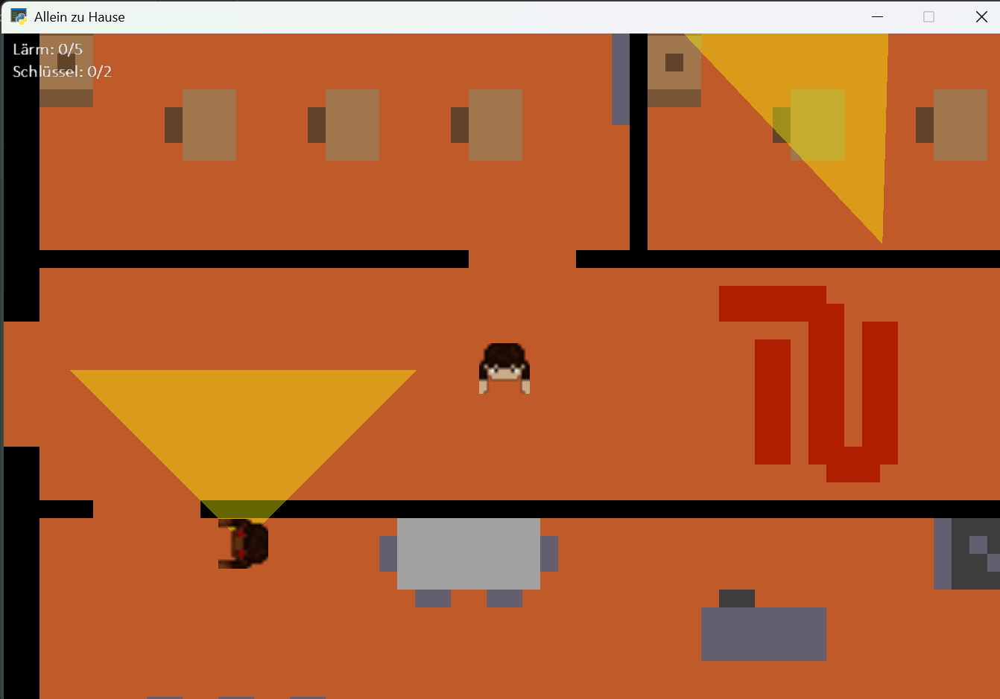
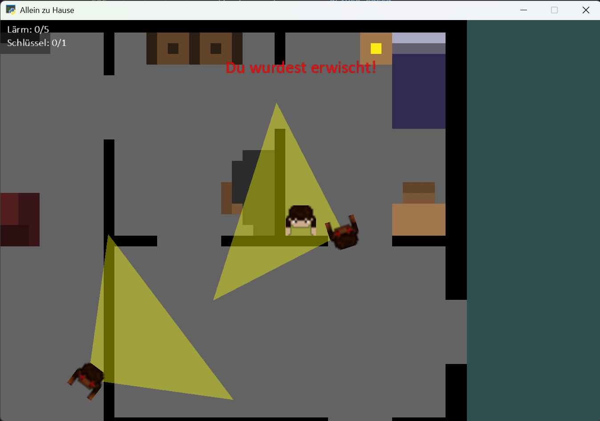

# Allein zu Hause (2D Stealth Game)

Ein atmosphärisches 2D-Top-Down-Stealth- und Rätselspiel, implementiert in Python unter Verwendung der Arcade-Bibliothek. Inmitten eines verheerenden apokalyptischen Ausbruchs muss der Spieler gefährliche Areale durchqueren, Sichtkegel feindlicher Kreaturen meiden, Schrittgeräusche minimieren und verborgene Schlüssel bergen, um die Flucht zu sichern.

## Screenshots

<table>
  <tr>
    <td align="center" width="50%">
      
      <br />
      <b>Schleichmechanik & Sichtkegel (Patrouille)</b>
    </td>
    <td align="center" width="50%">
      
      <br />
      <b>Sichtlinien-Kollision & Alarmzustand</b>
    </td>
  </tr>
</table>

## Story & Levelprogression

Du wachst vollkommen allein in deinem Zimmer auf. Eine unbarmherzige Apokalypse hat die Welt überrollt und selbst deine Eltern in aggressive, mutierte Kreaturen verwandelt. Eingesperrt im eigenen Haus bleibt nur eine einzige Option: das nackte Überleben.

- **Level 1 – Das Elternhaus:** Finde den in Schränken und Möbelstücken versteckten Hausschlüssel und erreiche unbemerkt die Eingangstür.
- **Level 2 – Die Universität:** Nach geglückter Flucht durchquerst du den verlassenen Universitätscampus auf der Suche nach Forschungsdaten und einem möglichen Heilmittel.
- **Level 3 – Der Hafen:** Im Hafengebiet patrouillieren die Mutanten in hoher Dichte. Finde die Schlüssel für das am Pier liegende Fluchtboot, um über das Wasser in Sicherheit zu gelangen.

## Gameplay-Mechaniken

- **Akustische Erkennung & Lärmkontrolle:** Kontinuierliche Bewegung treibt die Lärmanzeige (`Lärm-Pegel`) in die Höhe. Überschreitet das Geräuschlevel den Schwellenwert, werden die Monster sofort im gesamten Areal alarmiert – Gehörschutz vor Wänden gibt es nicht.
- **Sichtfeld & Raycasting-Verdeckung:** Die Kreaturen besitzen einen $90^\circ$-Sichtkegel. Wände und massive Möbelstücke schirmen den Spieler ab; eine Sichtung erfolgt erst bei freier Sichtlinie und ausreichender Nähe.
- **Geschwindigkeitsnachteil:** Die Mutanten bewegen sich signifikant schneller als der Spieler. Wird man entdeckt oder macht zu viel Lärm, ist ein Entkommen durch bloßes Wegrennen unmöglich. Schleichwege und Sichtschutz sind überlebenswichtig.

## Technical Highlights

- **Analytische Sichtlinien-Schnittberechnung (Raycasting):** Implementierung eines mathematischen Strecken-Rechteck-Schnitt-Algorithmus (`is_line_box_intersection`), der überprüft, ob Wände oder Hindernisse die Sichtlinie zwischen Gegner und Spieler schneiden, um falsche Positivsichtungen durch feste Objekte zu verhindern.
- **Geometrische Sichtkegelberechnung:** Vektorielle Distanz- und Winkelanalyse mittels euklidischer Norm und Arkustangens (`math.atan2`), um das periphere Sichtfeld der KI auf $45^\circ$ zu beiden Seiten der Blickrichtung zu begrenzen.
- **Zustandsbasierte Gegner-KI:** Automatischer Wechsel zwischen dynamischem Patrouillenmodus (Navigation über Wegpunkte, Türen und Raumzentren) und aggressivem Verfolgungsmodus bei optischer oder akustischer Ortung.
- **Dynamisches Tilemap-Parsing:** Einbindung und Skalierung strukturierter Kacheldaten aus Tiled (`.tmj`), inklusive getrennter Layer für Böden, Kollisionswände, Ausgänge und Schränke.

## Technologies

- **Programmiersprache:** Python 3
- **Engine / Framework:** Python Arcade
- **Level-Design & Maps:** Tiled Map Editor (`.tmj` JSON-Format)
- **Mathematik & Geometrie:** Standardbibliotheken `math`, `random`

## Steuerung

- **Pfeiltasten (↑, ↓, ←, →):** Spielerbewegung
- **R:** Neustart des Levels (nach Entdeckung oder nach Abschluss)

## Installation & Ausführung

### 1. Repository klonen
```bash
git clone https://github.com/LucasCalegari06/allein-zu-hause.git
```

### 2. Abhängigkeiten installieren
```bash
pip install -r requirements.txt
```

### 3. Spiel starten
```bash
python main.py
```
